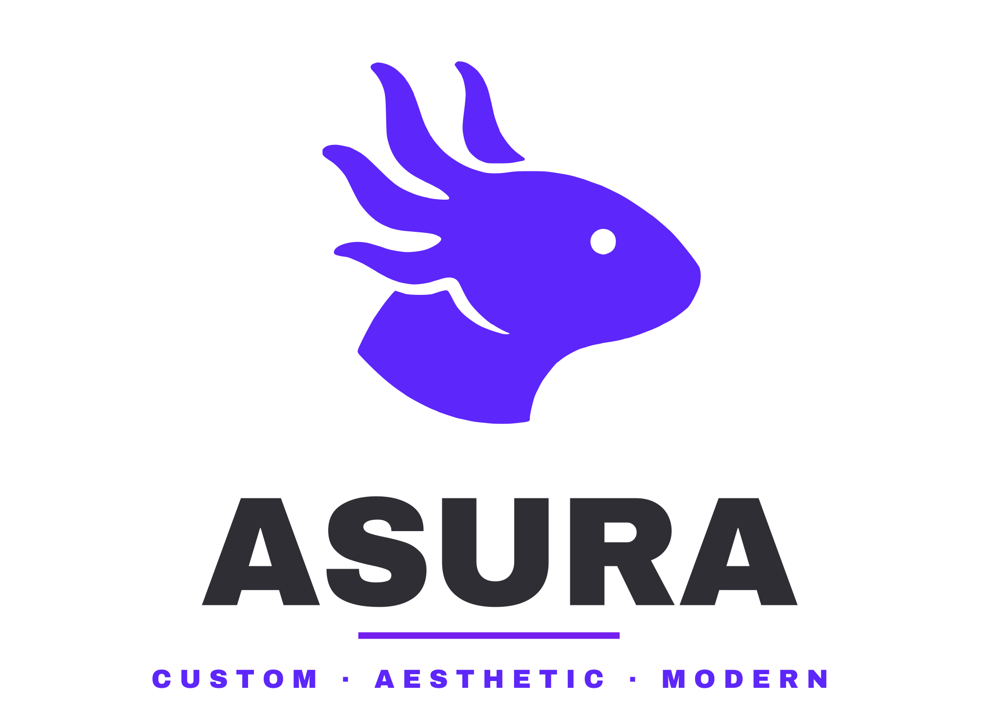

<p align="center">
  <picture>
    <source media="(prefers-color-scheme: dark)" srcset="./assets/asura-logo-dark.svg">
    <source media="(prefers-color-scheme: light)" srcset="./assets/asura-logo-light.svg">
    
  </picture>
</p>

<p align="center">
  <strong>The reactive desktop shell and Hyprland environment powering ASURA Linux.</strong>
  <br />
  Built with <b>Quickshell (Qt6/QML)</b>, <b>Python services</b>, and <b>Hyprland Lua configurations</b>.
</p>

<p align="center">
  
  
  
  
</p>

---

## 📂 Architecture & Directory Layout

```text
Asura-shell/
├── asura/                 # User config templates & default profiles
│   ├── config.json        # Default shell modules & preferences
│   ├── hypr-user.lua      # User-facing keybind overrides
│   └── hypr-vars.lua      # User-defined variables (gaps, default apps)
├── cli/                   # Asura management CLI tool
│   └── main.py            # Lifecycle management, IPC dispatcher & doctor
├── hypr/                  # Hyprland Wayland Compositor configurations
│   ├── hyprland.lua       # Main Hyprland Lua entrypoint
│   ├── hyprland/          # Modular Lua configs (keybinds, rules, execs, etc.)
│   ├── scheme/            # Dynamically generated border color schemes
│   └── scripts/           # Helper scripts (gamemode, caffeine, wallpaper)
├── Shell/
│   └── quickshell/        # Quickshell (Qt6/QML) root project
│       ├── shell.qml      # Main Quickshell entry point
│       ├── Modules/       # UI Windows & Panels (Bar, Launcher, ControlPanel, etc.)
│       ├── Services/      # Reactive backend daemons & D-Bus/Python bridges
│       ├── Components/    # Reusable Material Design 3 UI controls
│       └── Asura/         # Color palettes and visual assets
└── VERSION                # Current shell version identifier
```

---

## 🛠️ Local Development & Running

### Prerequisites & Dependencies

To build, test, and run the shell components locally, the following runtime and backend dependencies are required:

#### 1. Core Shell & Compositor
- **`quickshell`**: Reactive desktop shell runtime (Qt 6 / QML).
- **`hyprland`**: Dynamic Wayland tiling compositor (provides `hyprctl` and IPC socket).
- **Qt6 Packages**: `qt6-declarative`, `qt6-5compat` (GraphicalEffects), `qt6-wayland`.

#### 2. Backend Python Stack & Theming
- **`python3`** (3.10+): Powers background service daemons and the `asura` CLI.
- **`Pillow` (`PIL`)** & **`numpy`**: Fast image quantization and dominant color extraction for wallpapers.
- **`materialyoucolor`**: Material Design 3 dynamic tonal palette generator.
- **`uv`** *(recommended)*: Automatic Python virtual environment provisioning for wallpaper dynamic theming scripts.

#### 3. Audio & Hardware Integrations
- **Audio (`wpctl` & `pactl`)**: `wireplumber` (master volume/mute) and `pulseaudio-utils` / `libpulse` (per-app audio sink stream mixing).
- **Audio Visualizer**: `cava` (powers the real-time audio spectrum in the media player).
- **Network**: `networkmanager` (`nmcli` command for Wi-Fi scanning and connection control).
- **Bluetooth**: `bluez` / `bluez-utils` (`bluetoothctl` for pairing, scanning, and device states).
- **Brightness**: `brightnessctl` (screen backlight and keyboard brightness).
- **Power Management**: `upower` (battery metrics) and `power-profiles-daemon` or `tuned` (`powerprofilesctl` / `tuned-adm`).

#### 4. Desktop Session & Utilities
- **Clipboard**: `wl-clipboard` (`wl-copy`, `wl-paste`), `cliphist`, and `wtype` (synthetic paste event simulation).
- **Wallpaper Daemons**: `awww` or `swww` (smooth transitions and animated wallpaper daemon).
- **Screen Recording & Capture**: `wf-recorder` (Wayland video capture) and `grim` / `slurp` / `flameshot`.
- **Session & Security**: `hypridle` (idle daemon), `libpam` (PAM authentication for the lock screen), and `gammastep` (night light / color temperature).
- **MIME & Desktop Integration**: `xdg-utils` (`xdg-open`, `xdg-mime`, `xdg-settings`) and `gsettings`.

<details>
<summary><b>📦 Quick Install Command (Arch / Fedora)</b></summary>

**Arch / CachyOS:**
```bash
sudo pacman -S --needed quickshell hyprland hypridle qt6-declarative qt6-5compat qt6-wayland \
    python python-pillow python-numpy wireplumber libpulse networkmanager bluez-utils \
    brightnessctl wl-clipboard wtype cliphist awww wf-recorder grim slurp cava gammastep
```

**Fedora:**
```bash
sudo dnf install quickshell hyprland hypridle qt6-qtdeclarative qt6-qt5compat qt6-qtwayland \
    python3 python3-pillow python3-numpy wireplumber pulseaudio-utils NetworkManager bluez \
    brightnessctl wl-clipboard wtype cliphist awww wf-recorder grim slurp cava gammastep
```
</details>

---

### Running the Shell Directly
To run the shell during local development without installing globally:

```bash
# Start Quickshell pointing to this repository:
qs -p ./Shell/quickshell

# Or use the local CLI runner:
python3 cli/main.py run
```

### Reloading & IPC Testing
Send IPC commands directly to the active Quickshell instance:

```bash
python3 cli/main.py launcher toggle
python3 cli/main.py controlpanel toggle
python3 cli/main.py wallpaper toggle
python3 cli/main.py shortcuts toggle
python3 cli/main.py doctor
```

---

## 📡 IPC Endpoints & Services

Quickshell listens for IPC events exposed through `cli/main.py` via `ipc_call(target, action, *args)`.

| Target | Common Actions | Description |
| --- | --- | --- |
| `launcher` | `toggle`, `open`, `close` | Application grid & search menu |
| `controlpanel` | `toggle`, `open`, `close` | Quick settings, network, volume & toggles |
| `player` | `toggle` | Media player popup with CAVA visualizer |
| `wallpaper` | `toggle` | Wallpaper gallery selector & palette extractor |
| `clipboard` | `toggle` | Clipboard history search |
| `shortcuts` | `toggle` | Keyboard shortcuts cheat-sheet HUD |
| `switcher` | `next`, `prev`, `toggle` | Application window switcher (`Alt + Tab`) |
| `lock` | `toggle`, `lock` | Wayland lock screen overlay |
| `record` | `toggle` | Screen recording interface |

---

## 🎨 Dynamic Theming (Material You)

1. When a wallpaper is selected in `WallpaperSelector.qml`, it triggers `WallpaperService.qml` and `AutoTheme`.
2. Dominant tones are sampled to construct harmonious Material Design 3 tonal palettes.
3. Palettes are instantaneously pushed to:
   - Quickshell reactive color tokens (`Theme.surface`, `Theme.primary`, etc.).
   - Hyprland active/inactive border color schemes (`hypr/scheme/current.lua`).
   - GTK and terminal palettes.

---

## 🤝 Contribution & Commit Guidelines

When contributing to `Asura-shell`, please adhere to:
- **Commit Pattern**: Follow [Conventional Commits with Gitmoji](https://github.com/iuricode/padroes-de-commits) in **English** (e.g., `✨ feat(bar): ...`, `🐛 fix(player): ...`, `♻️ refactor(keybinds): ...`).
- **Code Style**:
  - **QML**: 4 spaces, clean property declarations, separate layout from business logic.
  - **Lua**: Modular configuration tables, minimal global pollution.
  - **Python**: PEP 8 compliance, proper exception handling.
