<p align="center">
  <picture>
    <source media="(prefers-color-scheme: dark)" srcset="./assets/asura-logo-dark.svg">
    <source media="(prefers-color-scheme: light)" srcset="./assets/asura-logo-light.svg">
    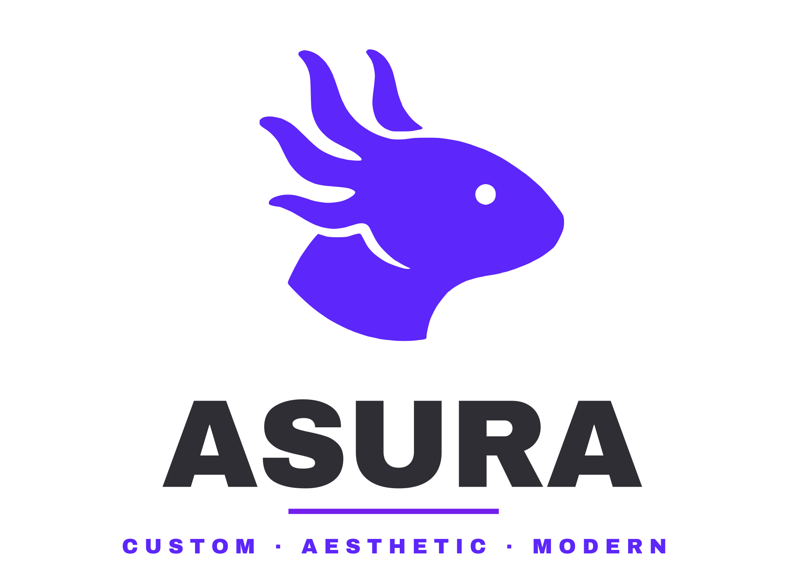
  </picture>
</p>

<p align="center">
  <strong>A modern, highly customizable Wayland desktop experience and shell.</strong>
  <br />
  Built with <b>Quickshell</b> (Qt/QML) and tailored for <b>Hyprland</b> with Material You dynamic theming.
</p>

<p align="center">
  <a href="#features"></a>
  <a href="#distributions"></a>
  <a href="#installation"></a>
  <a href="https://github.com/rlucas25/ASURA-linux/blob/main/LICENSE"></a>
</p>

---
<h2><sub></sub> Showcase</h2>

<h2><sub></sub> Screenshots</h2>

<div align="center">
  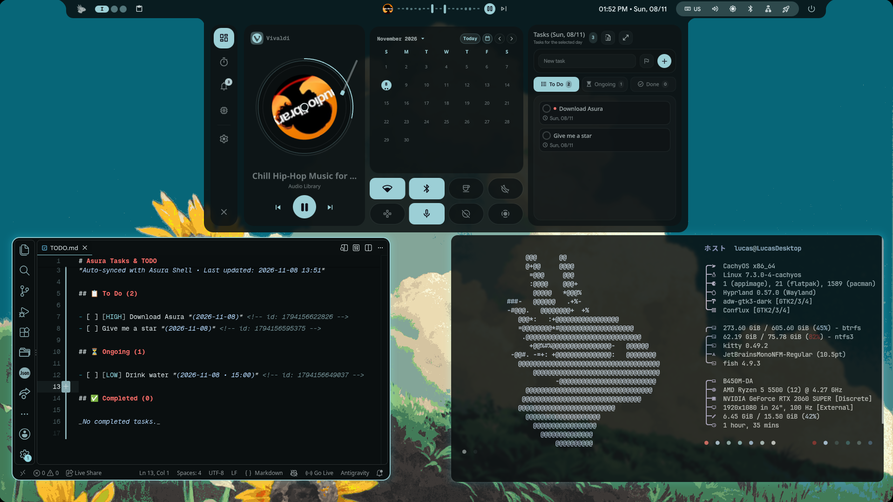

  <br />

  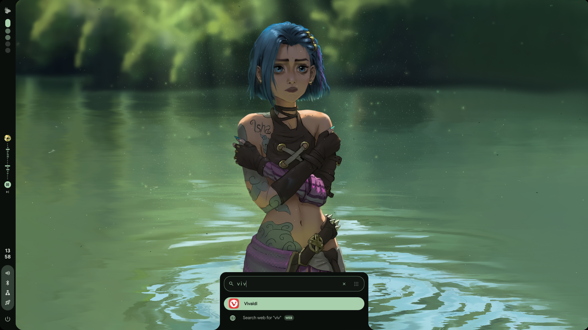
  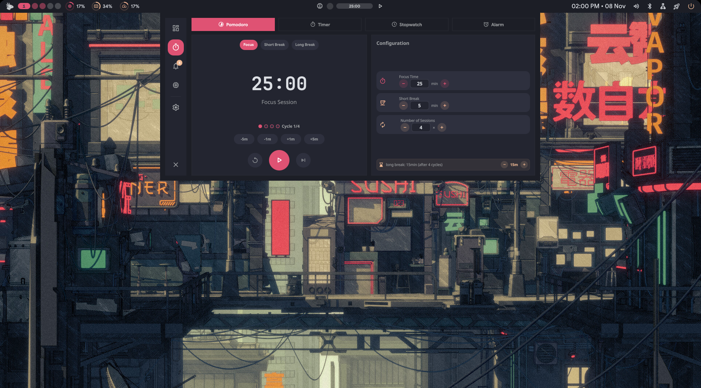
  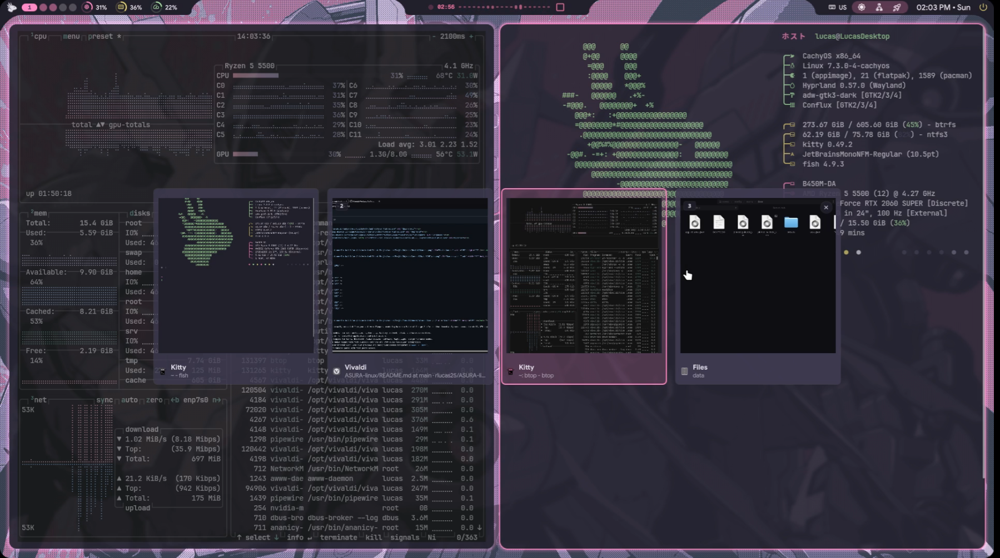

  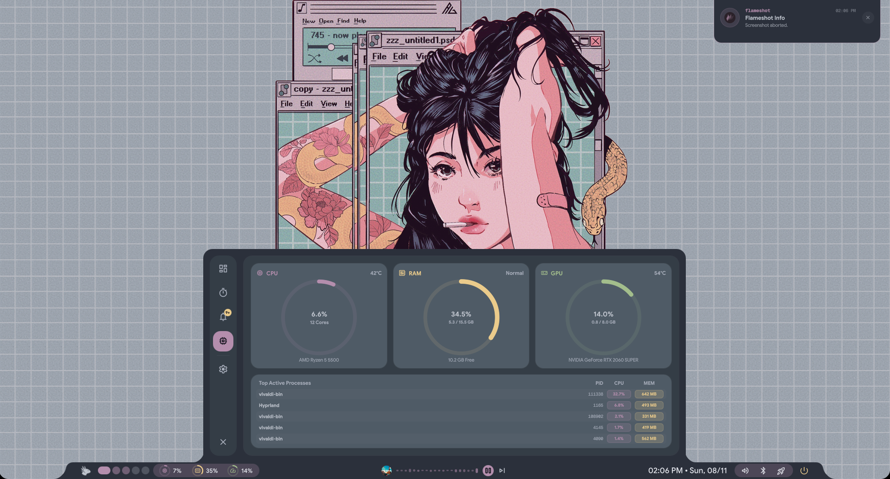
  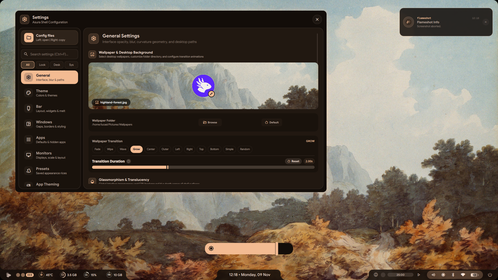
  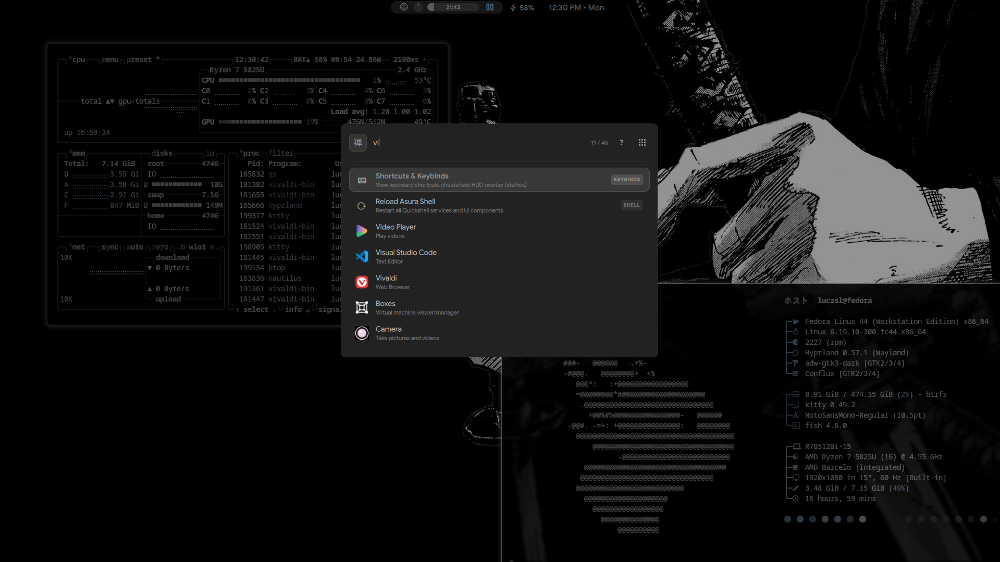

  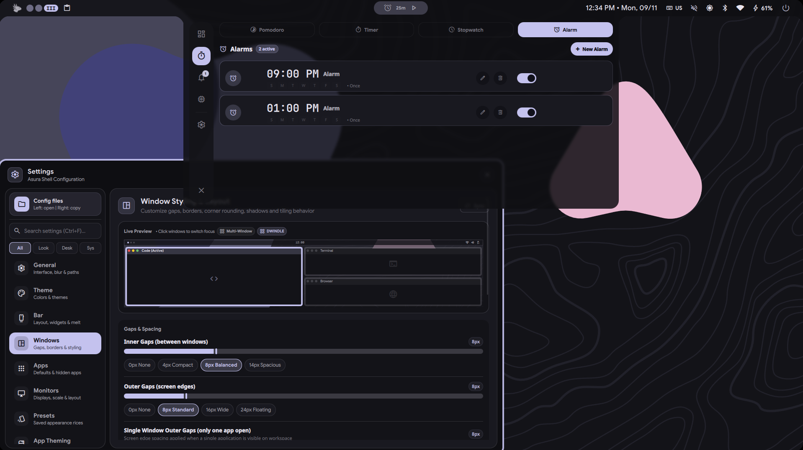
  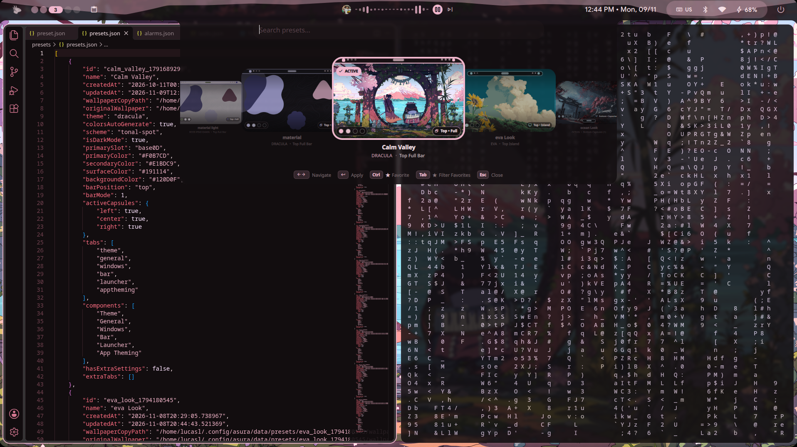
  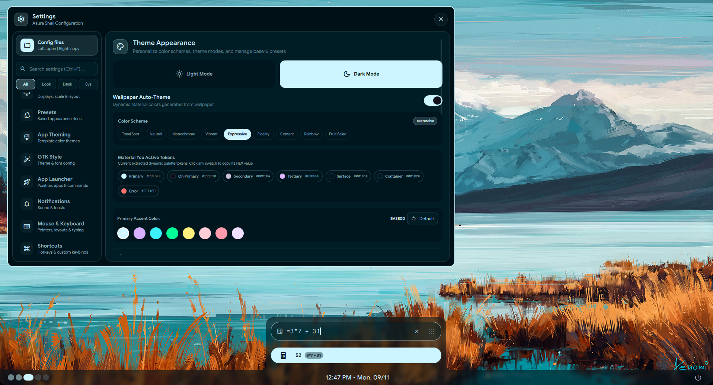
</div>


<h2><sub></sub> Features</h2>

- **Material You Dynamic Theming**: Colors dynamically extracted from your active wallpaper, producing harmonic Material Design 3 palettes that immediately sync across the shell, GTK applications, and Hyprland window borders.
- **Modular Shell Widgets (Quickshell)**:
  - **Status Bar**: Multi-monitor compatible, modular bar with workspaces, system tray, battery, network, clock, and hardware monitors.
  - **Application Launcher**: Searchable launcher for installed applications and quick actions.
  - **Control Panel & Quick Settings**: Quick toggles for Wi-Fi, Bluetooth, Audio devices, Caffeine, Night Light, and performance modes.
  - **Media Player & Visualizer**: Interactive media widget with full playback controls and CAVA audio visualizer integration.
  - **Wallpaper Selector**: Interactive wallpaper browser with live blur previews and background daemon management (`awww` / `swww`).
  - **Clipboard History**: Searchable clipboard manager panel with fast paste access.
  - **Lock Screen & OSDs**: Elegant lock screen and responsive on-screen display overlays for volume, brightness, and player status.
  - **Window Switcher**: Smooth visual window switcher (`Alt + Tab`).
- **Comprehensive GUI Settings**: Full configuration suite to customize themes, display setups, bar layout, notifications, widget positions, GTK themes, and custom keybindings.
- **Performance Modes**:
  - **Game Mode (`Super + G`)**: Instantly disables animations and blur for maximum gaming FPS.
  - **Caffeine Mode (`Super + Alt + C`)**: Keeps the display awake and inhibits idle lock/sleep.
- **Dedicated CLI (`asura`)**: Fast management tool for starting, reloading, diagnosing (`doctor`), updating, and sending IPC commands.
- **Tailored Hyprland Environment**: Modular Lua-based configuration (`hyprland.lua`) with multiple layout options (*dwindle*, *master*, *scrolling*, *monocle*), gestures, and window rules.


<h2><sub></sub> Distributions</h2>

Currently supported out-of-the-box:
- **Arch Linux** (Official repositories + AUR via `yay` or `paru`)
- **Fedora Linux** (DNF + COPR repositories)
- *More distributions coming soon (Debian/Ubuntu, openSUSE, NixOS)*


<h2><sub></sub> Installation</h2>

Clone the repository and run the automated installer:

```bash
git clone https://github.com/rlucas25/ASURA-linux
cd ASURA-linux
chmod +x install.py
./install.py
```

> [!TIP]
> During the installation it is normal for a composer window to be opened for the installation of some dependencies do not be alarmed and just wait


The installer detects your Linux distribution, enables any necessary external repositories (e.g. Fedora COPR), installs all system dependencies, fonts, cursor/icon themes, GTK configurations, and sets up your default environment.

### Installer Flags

You can customize the installer behavior using command-line arguments:

```bash
./install.py [options]
```

| Flag | Description |
| --- | --- |
| `--skip-deps` | Skip system package dependency installation |
| `--skip-themes` | Skip icon and cursor theme installation |
| `--skip-fonts` | Skip font installation |
| `-v`, `--version` | Show installer version number |
| `-h`, `--help` | Show help message and exit |


<h2><sub></sub> CLI Utility</h2>

After installation, the `asura` command will be available in your terminal:

```bash
asura <subcommand> [options]
```

| Argument | Description |
| --- | --- |
| `run` | Start Asura shell |
| `kill` | Kill Asura shell |
| `reload` | Restart Asura shell |
| `update` | Update Asura shell |
| `doctor` | Run diagnostic on Asura shell |
| `launcher` | Toggle or control App Launcher |
| `wallpaper` | Toggle or control Wallpaper Selector |
| `controlpanel` | Toggle or control Control Panel |
| `player` | Toggle or control Media Player widget |
| `settings` | Toggle or control Settings window |
| `clipboard` | Toggle or control Clipboard panel |
| `lock` | Lock screen or toggle lock screen |
| `switcher` | Control window switcher (next, prev, toggle) |
| `record` | Toggle or control Screen Recorder |
| `shortcuts` | Toggle or control Keyboard Shortcuts HUD |
| `toggle` | Toggle an Asura shell module |
| `ipc` | Call Quickshell IPC directly |
| `-h`, `--help` | Show help message and exit |
| `-v`, `--version` | Show program's version number and exit |


<h2><sub></sub> Keybindings</h2>

Asura comes pre-configured with intuitive default shortcuts:

### Shell & Utilities

| Shortcut | Action |
| --- | --- |
| <kbd>Super</kbd> | Toggle App Launcher |
| <kbd>Super</kbd> + <kbd>Shift</kbd> + <kbd>W</kbd> | Open Wallpaper Selector |
| <kbd>Super</kbd> + <kbd>A</kbd> | Open Control Panel / Quick Settings |
| <kbd>Super</kbd> + <kbd>P</kbd> | Toggle Media Player |
| <kbd>Super</kbd> + <kbd>Shift</kbd> + <kbd>C</kbd> | Open Settings Window |
| <kbd>Super</kbd> + <kbd>V</kbd> | Open Clipboard Manager |
| <kbd>Super</kbd> + <kbd>L</kbd> | Lock Screen |
| <kbd>Super</kbd> + <kbd>/</kbd> | View Keyboard Shortcuts (`asura shortcuts`) |
| <kbd>Alt</kbd> + <kbd>Tab</kbd> | Next Window (Switcher) |
| <kbd>Alt</kbd> + <kbd>Shift</kbd> + <kbd>Tab</kbd> | Previous Window (Switcher) |
| <kbd>Super</kbd> + <kbd>Alt</kbd> + <kbd>R</kbd> | Toggle Screen Recording |
| <kbd>Print</kbd> / <kbd>Super</kbd> + <kbd>Shift</kbd> + <kbd>S</kbd> | Take Screenshot (`flameshot`) |
| <kbd>Super</kbd> + <kbd>G</kbd> | Toggle Game Mode (disables blur & animations) |
| <kbd>Super</kbd> + <kbd>Alt</kbd> + <kbd>C</kbd> | Toggle Caffeine Mode |

### Applications

| Shortcut | Application |
| --- | --- |
| <kbd>Super</kbd> + <kbd>T</kbd> / <kbd>Super</kbd> + <kbd>Enter</kbd> | Terminal (`kitty`) |
| <kbd>Super</kbd> + <kbd>B</kbd> | Web Browser (`vivaldi`) |
| <kbd>Super</kbd> + <kbd>C</kbd> | Code Editor (`code`) |
| <kbd>Super</kbd> + <kbd>E</kbd> | File Explorer (`nautilus`) |
| <kbd>Ctrl</kbd> + <kbd>Alt</kbd> + <kbd>V</kbd> | Audio Control (`pavucontrol`) |

### Window Management

| Shortcut | Action |
| --- | --- |
| <kbd>Super</kbd> + <kbd>Q</kbd> | Close active window |
| <kbd>Super</kbd> + <kbd>W</kbd> | Toggle floating / centered mode |
| <kbd>Super</kbd> + <kbd>F</kbd> | Bordered Fullscreen (Maximized) |
| <kbd>Super</kbd> + <kbd>Shift</kbd> + <kbd>F</kbd> | Fullscreen |
| <kbd>Super</kbd> + <kbd>Tab</kbd> | Cycle layouts (*dwindle*, *master*, *scrolling*, *monocle*) |
| <kbd>Super</kbd> + <kbd>Arrow Keys</kbd> | Change window focus |
| <kbd>Super</kbd> + <kbd>1-9</kbd> | Switch to workspace 1-9 |
| <kbd>Alt</kbd> + <kbd>1-9</kbd> | Move active window to workspace 1-9 |
| <kbd>Super</kbd> + <kbd>S</kbd> | Toggle Special (Scratchpad) workspace |

> [!TIP]
> Keybindings can be easily customized through the **Asura Settings** GUI or in `~/.config/asura/hypr-user.lua`.


<h2><sub></sub> Configuration & Directory Structure</h2>

Asura follows the standard XDG directory layout:

```text
~/.config/
├── asura/                 # User customizations and shell state
│   ├── config.json        # Active configuration, presets and widget preferences
│   ├── hypr-user.lua      # User-defined Hyprland rules and keybind overrides
│   └── hypr-vars.lua      # App defaults, gaps, and aesthetic variables
├── hypr/                  # Hyprland base configuration (Lua)
└── kitty/                 # Kitty terminal config
~/.local/share/
└── asura/                 # Asura Shell source (Quickshell & QML modules)
```


<h2><sub></sub> Diagnostics</h2>

To verify your setup and ensure all system utilities and dependencies are working properly:

```bash
asura doctor
```

This diagnostic tool checks for the presence of Quickshell, Hyprland, Wallpaper daemons, Screen Recorder, Audio Visualizer, and core tools.


<h2><sub></sub> Support & Contributing</h2>

Contributions, bug reports, and feedback are always welcome!

- **Bug Reports & Requests**: Please open an issue on [GitHub Issues](https://github.com/rlucas25/ASURA-linux/issues).
- **Contributing**: Fork the repo, create a branch with your improvements, and submit a Pull Request.


<h2><sub></sub> Credits & Acknowledgements</h2>

- **[Quickshell](https://quickshell.outfoxxed.me/)** by [outfoxxed](https://outfoxxed.me/) — the reactive Qt/QML framework powering Asura's shell widgets.
- **[Tinted Theming](https://github.com/tinted-theming/schemes)** — curated Base16 / Tinted Schemes color palettes and their respective scheme authors (MIT License).
- **[iNiR](https://github.com/snowarch/inir)** by [snowarch](https://github.com/snowarch) & **[illogical-impulse](https://github.com/end-4/dots-hyprland)** by [end-4](https://github.com/end-4) — for the Material You / Material Design 3 dynamic color generation algorithms and integration inspiration.
- **[Hyprland](https://hyprland.org/)** by [Vaxry](https://github.com/vaxerski) and contributors — for the dynamic tiling Wayland compositor.
- **[hyprland-scroll-overview](https://github.com/yayuuu/hyprland-scroll-overview)** by [yayuuu](https://github.com/yayuuu) — for the smooth workspace overview plugin.
- **[Bibata Cursor](https://github.com/ful1e5/Bibata_Cursor)** by [Kaizvalter](https://github.com/ful1e5) — for the clean cursor theme.
- **[Animated Fluent Emojis](https://github.com/Tarikul-Islam-Anik/Animated-Fluent-Emojis)** by [Tarikul Islam Anik](https://github.com/Tarikul-Islam-Anik) — for the expressive UI emoji assets.

*(If you contributed to any component or your project is referenced and not listed, please reach out or open a PR! 🙏)*


<h2><sub></sub> License</h2>

Asura Shell is licensed under the **[GNU General Public License v3.0 (GPL-3.0)](https://www.gnu.org/licenses/gpl-3.0.en.html)**.

- **Shell & Core Code**: GPL-3.0 (in compliance with upstream GPL-3.0 derivatives from iNiR).
- **Color Schemes & Palettes**: Base16 schemes from [Tinted Theming](https://github.com/tinted-theming/schemes) are distributed under the [MIT License](https://github.com/rlucas25/ASURA-linux/blob/main/Asura-shell/Shell/quickshell/Asura/palettes/LICENSE-tinted-schemes.txt).
- **Fonts & Assets**: Subject to their respective upstream licenses (OFL, Apache-2.0, Creative Commons).
